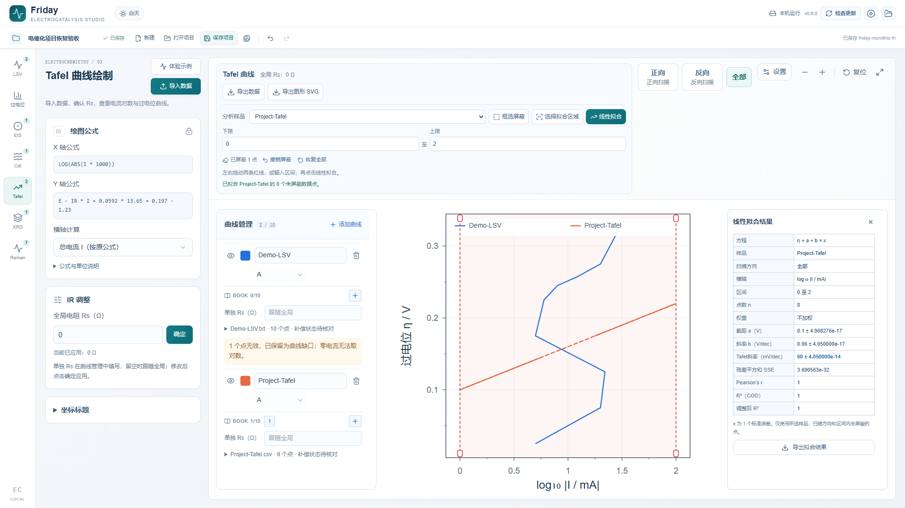

# Friday · 电催化科研工作台

Windows x64 科研数据绘图桌面应用，当前桌面研发预览版 **0.6.0**。九个工作台：**LSV、过电位、EIS、Cdl、CV/Ks、Tafel、pH 依赖性、XRD、Raman**。EIS 同一批数据可切换 Nyquist、原位等高线与原位 Bode；Bode 支持多电位的阻抗模值/相位双图、单图及相位符号选择。导入数据、样品组、图形设置和完整原始点随 Fri 项目保存。

[GitHub 源码](https://github.com/lwr041074768/Friday) · [Gitee 项目](https://gitee.com/lwr2571166871/lwr) · [Gitee 发行版](https://gitee.com/lwr2571166871/lwr/releases) · [English](README.en.md) · [中文 PDF 使用说明书](docs/科研绘图台使用说明书.pdf) · [检查记录](docs/VALIDATION.md)



## 下载与运行

1. 在发行版中核对版本号，下载同一版本的全部桌面分片（如提供 `.zip.001`、`.zip.002`），以及合并脚本。按该版发行说明合并并校验 SHA256。当前源码为 0.6.0 研发预览版；可用二进制以各发行页实际附件为准。
2. 解压完整 ZIP，运行文件夹中的 `ScientificPlotStudio.exe`。请保留整个目录。
3. 升级前先保存项目或导出需要的数据，再完全退出旧程序；双击新版后核对右上角版本。旧版未退出时，单实例机制可能只唤回旧窗口。

菜单“帮助 → 使用说明书（PDF）”可打开随包提供的历史离线说明书（当前为 0.5.1，正式发行时集中更新）。0.6.0 的 EIS 三视图见 [发行说明](docs/RELEASE-0.6.0.md)，其余变更见 [更新记录](CHANGELOG.md)。“检查更新”由用户主动触发，当前从 Gitee 发行版读取更新信息，下载校验完成后可选择重启安装。顶部“保存项目”将九个工作台的导入数据、分析设置和浮动 BOOK 保存到 .fri，打开后恢复；退出前请保存需要的项目。

保存类型为 **Fri**；旧版 `.ecproj` 可打开并另存为 `.fri`。各工作台采用左参数、右画布布局，X/Y 范围与主次刻度集中在画布的“设置”中；Cdl 双图与 Raman 两种图形可分别调整。

## 工作台功能

| 工作台 | 功能 |
| --- | --- |
| LSV | 原始列映射、已应用 IR、扫描段选择、峰后目标交点与完整数据导出 |
| 过电位 | 同步 LSV 样品与当前读数、多种柱图样式、坐标设置、Origin 可编辑图 |
| EIS | Nyquist、原位等高线、原位 Bode，共用实测电位与频率；112 种电路自动选优、候选检查、拟合报告、完整数据导出 |
| Cdl | 十个数据组、多扫速 CV、正反扫取点、选圈、独立电极拟合与统计、Excel/CSV/SVG/Origin |
| CV/Ks | 多扫速与样品分组、选圈及峰位调整、半峰间距拟合与 Laviron Ks、逐扫速结果、Excel/CSV/图形导出 |
| Tafel | 总电流或电流密度对数换算、Rs 校正、矩形屏蔽、双线选区、不加权线性拟合与统计、完整 CSV 与 SVG |
| pH 依赖性 | 按样品导入多 pH 曲线、共同电位取值、固定原始电位或 RHE、log j–pH 拟合、完整数据与 Origin 导出 |
| XRD | MDI/文本/Excel、叠加/堆叠/归一化、当前 JADE 9 卡片峰棒、Origin 导出 |
| Raman | Optosky 六列识别、文件夹分组、堆叠/填色等高线、真实电位或序号轴、CSV/SVG/Origin |

LSV/Tafel/XRD 每页通常最多 20 条；EIS 和 Raman 最多 80 条。通用单文件上限 20 MB；批量和 Origin 另有总量限制，见说明书。内部缺失值保留为断点，原始列与绘图列分别保存。

X、Y 范围、主次刻度和标题可在画布“设置”中调整；通用线图支持倒数轴、双 Y 轴、上轴、断轴和注释。Tafel 使用固定的电流对数坐标，EIS Bode 使用频率对数轴；旧项目保存的通用对数轴设置继续兼容。各工作台按其分析定义提供相应坐标选项。

出图支持 SVG、PNG、TIFF 与矢量 PDF；SVG/PDF 按毫米确定物理尺寸，PNG/TIFF 可设 150–1200 dpi 并保留 DPI 元数据和可选透明通道。EIS 新项目默认对 112 种电路进行自动筛选，支持进度、取消、候选排名、手动选模和电路图，给出参数 ± 标准误差、χ²、残差 RMS 并叠图。模型与计算来源见 [模型文档](docs/eis-zsimp-models.md)。Tafel 提供候选线性区建议；总电流模式报告外推 I₀（mA），密度模式报告外推 j₀（mA cm⁻²），并给出固定区间下的斜率 95% 置信区间。EIS 的电路、加权与拟合请求随 .fri 保存，重开后根据真实数据重新计算，可独立导出参数、逐点残差与候选排名 CSV。

LSV/Tafel 的 BOOK 可添加最多 4 个公式计算列（a/b/x/y）、查看列统计并随 CSV 导出。文本数据表最多 20 万行。编辑中每分钟及窗口隐藏时写入自动恢复副本，异常退出后下次启动可恢复；撤销保留 120 步。

LSV 与 Tafel 支持每样品最多 10 本可移动 BOOK：A/B 原始列、空白 C、D/E 当前计算列，IR 确认后联动。项目操作提供撤销/重做；请另行备份仪器原件。

使用者需核对换算中的参比、pH、温度、有效面积及仪器补偿状态。Tafel 数值拟合需选择有实验依据的线性区；OER、ECSA、Rct 和机理解释需结合对应实验条件与模型假设。

## 可选的本机软件

- Origin / OriginPro：桌面版内置连接程序，无需安装旧网页助手；已验证 OriginPro 2024。按页面功能创建独立可编辑工作表或图，完成后在 Origin 保存项目。
- JADE：当前适配 JADE 9 中文版的一张已打开卡片详细窗口；读取用户本机已打开卡片的峰位。JADE、Origin 与标准卡数据库由使用者自行合法安装和授权。

已验证环境和适用条件见 [检查记录](docs/VALIDATION.md)。说明书截图使用模拟数据，供演示操作与界面。

## 从源码构建桌面版

本次构建使用 Node.js 24.15.0、Electron 44.7.0 和 Windows x64。需要联网获取依赖及官方运行时。

```powershell
npm ci
npm --prefix desktop ci
node desktop/install-runtime.mjs
npm run desktop:typecheck
npm run desktop:build
npm run desktop:package
```

输出在 `desktop/release/`。打包要求 `docs/科研绘图台使用说明书.pdf` 存在，并将它随包提供。手册重建脚本为 `scripts/build-manual.py`，需 Python、ReportLab 和可嵌入的中文字体；普通使用者无需这些依赖。

```powershell
npm run desktop:check
node desktop/verify-ui.mjs --playwright <已安装的playwright/index.mjs> --output desktop/output/ui-audit
```

计算与导出验证使用构造数据，部分脚本在本机存在此前实验测试文件时额外读取验证；实验原件保存在研究者本机。

## 仓库结构与旧版

- `desktop/`：Electron 主进程、预加载、桌面界面适配与打包。
- `app/`、`components/`、`lib/`：当前桌面共享的工作台源码。
- `docs/`：PDF、文字说明、模拟截图、检查与发行说明。
- `src/`：保留的旧浏览器独立版 1.0.0 源码，继续使用原有 `npm run dev/build`；它与当前 Electron 桌面版使用不同版本线。旧版服务启动器与发布脚本仅为历史兼容保留，不用于当前桌面发行。

本仓库提供独立绘图桌面应用源码。原网站的登录认证、文献管理、数据库、环境配置及个人实验原件由各自系统单独保存。

## 许可证

应用源码采用 [MIT](LICENSE)。第三方许可证在 [third-party](third-party/DEPENDENCIES.md)，其中桌面 UI 使用的 vendor 样式保留相应原始许可证。Electron 发行包同时保留其自带许可文件。Origin、JADE 和标准卡数据库的权利归各自权利人。
